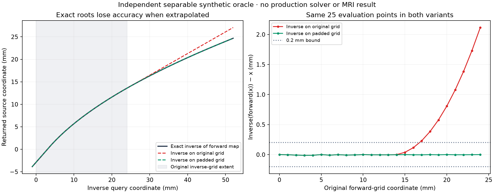

# HalfFlow boundary inverse representation diagnosis

The historical r24 identity-initialized forward residuals contain local
trilinear-cell folds that their positive voxel-difference Jacobians miss.
The existing complete-cell evaluator detects them, and independent
finite-difference probes confirm local reversals away from interpolation knots.
This is a concrete additional defect in the authoritative forward maps;
inverse refinement alone cannot repair it.

A separate exact oracle also establishes a boundary representation limitation.
Neither more accurate pointwise root solving nor the declared padding method
passes the full-boundary contract on the actual r24 fields. No production
method is changed or qualified by these diagnostics.

## Exact piecewise-linear oracle

The original grid contains 25 points from 0 through 24 mm at 1 mm spacing.
Prescribed forward samples define a piecewise-linear map with exterior linear
continuation. Its exact inverse is obtained by exchanging the strictly ordered
forward sample values and their original coordinates. This avoids numerical
root-solving error. The one-dimensional map embeds as `(F(x), y, z)` in three
dimensions, with positive cell Jacobians.

Three maps and both inverse representations were declared before computation:
translation `x + 3`, affine `1.05 x + 3`, and nonlinear samples
`x + 3 + 0.04 x²`. In each case, the inverse is sampled either on the original
target grid or on a grid at the same spacing that encloses the original target
grid and all forward sample coordinates, with one extra cell on each face.
Both compositions always retain the same 25 original evaluation points.

| Forward map | Maximum round-trip error, original inverse grid | Maximum round-trip error, padded inverse grid |
| --- | ---: | ---: |
| Translation | 0 mm | 0 mm |
| Affine | 3.56 × 10⁻¹⁵ mm | 1.78 × 10⁻¹⁵ mm |
| Monotone nonlinear | 2.115385 mm | 0.012000 mm |

The pointwise inverse oracle is accurate within `1e-12` mm in both compositions
for every case. Thus the 2.115 mm error is introduced by interpolation and
exterior continuation of the stored inverse. Both inverse-grid variants have
positive cell slopes; the large round-trip error does not require a fold.
Padding reduces the nonlinear example below the existing 0.2 mm diagnostic
bound, without removing points or relaxing that bound. It is a constructive
counterexample and mitigation, not a general guarantee for arbitrary 3D maps.

The [declaration and complete results](evidence/halfflow-boundary-20261014/representation-v1/artifact-manifest.json)
retain every sampled coordinate, inverse value and composition error. Four
oracle checks cover exterior affine accuracy, exact inverse knot exchange,
unchanged denominators and rejection of invalid inputs.

## Frozen-field follow-up

The [separately declared C04 capture and r24 root analysis](evidence/halfflow-boundary-20261014/c04-declaration-v1/artifact-manifest.json)
retain the original numerical
policies and production source. The current canonical-provider runner differs
from the original diagnostic's pre-migration runner; its explicit adapter diff
is recorded. Attribution to historical r24 requires both forward residual
hashes to replay exactly. Current admission outcomes are distinct from the
historical topology-only follow-up because endpoint inverse admission was
subsequently strengthened.

The independent 3D sampler differentiates the same boundary-linear trilinear
map in world coordinates. A bounded Newton solve uses 40 iterations, a 4 mm
step cap, 12 backtracking halvings and a `1e-8` mm equation tolerance. The
prospective comparison uses the original and padded inverse grids and also
solves directly at forward-node queries. Invalid samples, unresolved roots and
nonpositive root Jacobians remain explicit. A small equation residual alone
does not prove uniqueness, global invertibility or complete-cell topology.

Nine combined oracle checks pass, including oblique anisotropic affine fields,
independent finite-difference derivatives, exterior root solves, invalid
support and the unchanged original denominator on a larger inverse grid.

## Actual r24 results

The [completed capture and follow-ups](evidence/halfflow-boundary-20261014/c04-outcomes-v1/artifact-manifest.json)
retain all declarations, scalar outcomes, failed preparations and exact field
identities. All 24 C4 forward/inverse fields across six cases replay their
historical hashes exactly, including all four r24 fields. The independent
sampler reproduces r24's original whole-field inverse maxima of 3.417999 mm
and 8.086230 mm, and its interior maxima of 0.043788 mm and 0.060772 mm.
Every original composition keeps 50,653 target points; the six-voxel interior
contains 15,625 and its boundary complement contains 35,028.

The [source compatibility receipt](evidence/halfflow-boundary-20261014/source-compatibility.json)
verifies that all 285 Scala sources in the existing reconstructible
`5b792b86…` engine match the current files, and every source shared with this
capture's declaration matches exactly. Other benchmark files outside the
capture manifest are listed explicitly.
The [acquired-grid reproduction chain](halfflow-acquired-grid-audit-v1.md)
therefore supplies the numerical source; this work adds diagnostic scripts and
generated logging only.

| r24 arm | Original stored inverse, worst whole-field error | Same-grid solved roots, inverse(forward(x)) error | Unresolved roots, original / padded inverse grid |
| --- | ---: | ---: | ---: |
| Fixed | 3.417999 mm | 2.874598 mm, all 50,653 evaluated | 0 / 130 |
| Moving | 8.086230 mm | 3.345792 mm, 9 invalid compositions | 2 / 127 |

The fixed-arm roots solve `forward(inverse(y)) = y` within `1e-8` mm at every
original target node, with positive local root Jacobians. The opposite sampled
composition still fails. The moving-arm solve retains two unresolved nodes;
its evaluated equation residuals are below `1e-8` mm, but that is not a pass
with missing roots. Padding uses a 41³ inverse grid, preserves the original
50,653-point composition denominators, and fails in both arms. Its unresolved
roots, large residuals and invalid compositions are retained. A bounded solver
failure does not prove that a root is absent; no extra iterations or alternative
seeds are selected after these outcomes.

The separately declared root-witness follow-up reproduces every primary scalar
root receipt exactly. Direct queries expose alternate-preimage evidence and
nonpositive one-sided derivatives, but several occur at interpolation knots.
Those knot derivatives cannot alone certify a smooth local fold. A second
declared follow-up moves each of all 13 such root locations toward its selected
cell center by both fixed fractions, `0.001` and `0.0001`. All **26 smooth-cell
probes** have negative analytic and finite-difference determinants, with maximum
derivative-matrix disagreement below `1.1e-9` (declared limit `1e-7`). Twenty-two
probes lie inside the original grid, in one fixed-arm cell and ten moving-arm
cells; four lie in the exterior continuation. This confirms that the problem
includes both interior boundary-cell geometry and the extended map, rather
than just ambiguous derivatives at knots.

## Complete-cell audit of all captured fields

The final follow-up applies the **unchanged existing evaluator** to all 48
captured fields, without selecting cases or locations. Each field retains all
46,656 complete cells at eight corners and center, with 100% coverage. Every
voxel-difference topology report has zero nonpositive Jacobians, yet the
complete-cell results differ:

| Current lane and field kind | Fields passing existing cell criteria | Fields containing nonpositive cell samples |
| --- | ---: | ---: |
| Identity-initialized C4 forward residuals | 3 / 12 | 9 / 12 |
| Identity-initialized C4 stored inverses | 9 / 12 | 3 / 12 |
| Affine-initialized C5 forward residuals | 12 / 12 | 0 / 12 |
| Affine-initialized C5 stored inverses | 12 / 12 | 0 / 12 |

For r24, the fixed forward residual has **12 folded cells** and minimum cell
Jacobian **−0.222107**, while the moving forward residual has **33** and
**−1.556543**. Their voxel-difference minima are positive, 0.612304 and
0.289369. The stored inverse fields have 32 and 57 folded cells respectively.
These are existing historical C4 fields, not numerical changes introduced by
the diagnostic. The current C5 fields all pass, but none of their 24 hashes
replays the historical C5 fields exactly; the archive records every mismatch.
They are current controls, not a claimed neutral replay of the old upstream
Flashalign implementation.

The original topology-only explanation is therefore incomplete: positive
voxel-difference Jacobians did not establish valid trilinear forward maps.
R02 must enforce the applicable cell contract on authoritative forward states,
then address extension/branch selection and both inverse compositions on
admitted states. Improving the inverse solver against a folded forward field
cannot establish an inverse contract. The nine-sample check remains sampled
evidence; a passing result is not a proof of global continuous invertibility.

R02 and D02 remain open. These are observed synthetic C04 diagnostics, not new
MRI registration-accuracy evidence. The running MRI trajectories and the
corrected-gradient screen retain their existing protocols and prerequisites.
