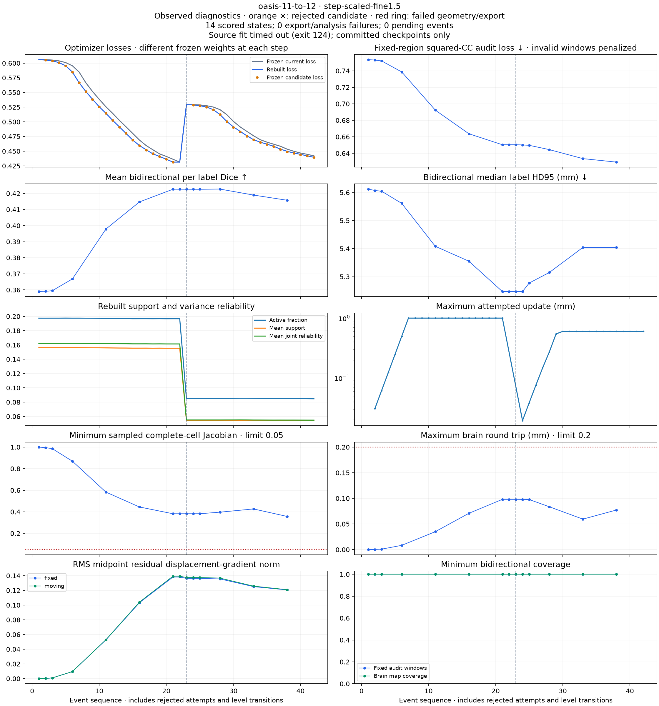

# HalfFlow checkpoint export and fine-level anatomy loss

The revised diagnostic capture reproduces the original control exactly while
moving checkpoint export out of fitting. Separately, the completed scoring of
one timed-out trajectory shows that fine refinement can improve both intensity
objectives while worsening anatomical overlap. Neither finding qualifies
HalfFlow or establishes an anatomical improvement.

This is HFQ-D01 evidence for Mote `bd-01M4X4DY7DQCVK33MCK3T17NA1`.
The [evidence manifest](evidence/halfflow-deferred-capture-20261014/artifact-manifest.json)
retains protocols, receipts, failed attempts, source patches, checks and figures.
Large MRI and map arrays remain local with recorded hashes.

## Capture neutrality

The original synchronous-export panel ended with one successful fit, two
one-hour timeouts and seven explicit cancellations. Its entire attempt ledger
remains in the [objective-probe archive](halfflow-objective-probe-v1.md).
The replay retains the same five pairs, two existing policies, checkpoint
selection, 24-state budget and one-hour per-fit deadline.

An explicit `--checkpoint-defer-export true` option writes raw midpoint maps,
validity, affine factors and scalar events during optimization. Each saved state
is marked as awaiting export. Ordinary final export and admission still occur
inside the fit deadline. Offline checkpoint exports have their own frozen
inputs, process measurements, deadlines and receipts in a separate directory.

Before expanding the replay, the OASIS 11 → 12 selected control passed the
[complete neutrality check](evidence/halfflow-deferred-capture-20261014/trajectories-deferred-v2/neutrality-verification.json):

- All 30 scalar events and capture selections agree exactly.
- All 13 raw states agree exactly across 130 saved artifacts.
- All 15 compared final files agree exactly, including optimizer diagnostics,
  both native pull maps, validity, warped images and residual maps.
- All 20 offline-export artifacts agree exactly across the original coarse-start
  and fine-start checkpoints, including native admission status and diagnostics.

The fit exited successfully after 1,196.27 diagnostic wall seconds. Concurrent
work makes this unsuitable for a runtime comparison. Its optimizer still ends
with the original accepted-step budget/controller exhaustion behavior; this
replay does not turn that behavior into convergence.

## Preserved failures and correction

The first offline-export attempt failed exact parity on both checkpoints.
Maximum forward-coordinate differences were `1.09e-12` and `1.35e-12` mm;
backward maps and validity were unchanged. The original midpoint initializer
constructs affine arms as `(root.inverse, root)`. The canonical affine stores
both directions, so independently re-inverting the serialized fixed arm loses
the exact cached root through floating-point rounding.

The corrected loader reconstructs the original pair from the moving root and
requires exact agreement with every saved fixed-arm coefficient. An inconsistent
pair is rejected. Both checkpoint exports then pass byte equality without a
tolerance change. A focused regression checks both cached affine directions;
the grid test also checks oblique coefficients and the native live frame owner.

The initial ten runner/loader/grid checks passed; both focused affine/grid
checks passed after the correction. The archive also retains an sbt launch
failure caused by cache permissions and an aborted freeze caused by the Git
file list exceeding Node's default output buffer. Increasing that buffer changes
neither source selection nor registration numerics.

## A fixed intensity audit can improve while anatomy worsens

All 42 committed events from the original OASIS 11 → 12 step-scaled run have
analysis receipts. Fourteen states were captured and scored; every scored state
passes the current native/common geometry and sampled-cell checks. The source
fit timed out and remains a failed fit. Its incomplete, uncommitted step-20
directory is not promoted to a captured state or a final result.

| Fine accepted steps | Optimizer rebuilt loss ↓ | Independent fixed-audit loss ↓ | Mean bidirectional Dice ↑ | HD95 (mm) ↓ |
| ---: | ---: | ---: | ---: | ---: |
| 0 | 0.529247 | 0.650371 | 0.422652 | 5.246936 |
| 1 | 0.528819 | 0.650137 | 0.422615 | 5.246936 |
| 2 | 0.527537 | 0.649676 | 0.422617 | 5.277353 |
| 5 | 0.512420 | 0.644460 | 0.422738 | 5.315000 |
| 10 | 0.469591 | 0.633549 | 0.419009 | 5.404319 |
| 15 | 0.449892 | 0.629331 | 0.415789 | 5.404319 |

The independent audit retains its fixed target masks and window population;
both directions have full window coverage at these states. Its loss improves
alongside the optimizer loss while Dice declines after step 5. Changing
optimizer weights alone therefore cannot explain this case's anatomical loss.
The lower displacement-gradient norm during fine refinement also cautions
against simply describing this as excessive deformation complexity.

The [per-structure figure](evidence/halfflow-deferred-capture-20261014/partial-step-scaled-figures-v2/per-structure.png)
retains all 62 labels in both directions. These observed labels diagnose the
trajectory; they do not select a stopping point or an output for deployment.
This single partial trajectory does not establish a population-level effect.

The [full partial-panel scoring supplement](evidence/halfflow-deferred-capture-20261014/partial-panel-analysis-supplement-v1/artifact-manifest.json)
now accounts for all 124 committed events across the original ten fit attempts:
47 captured states were scored and 77 events requested no retained state.
There are no analysis/export-unavailable failures among those committed states;
all 47 pass the current common geometry and sampled-cell checks. The two timed-out
and seven cancelled fits retain their original failed outcomes. Five cancelled
fits produced no committed events and remain in the fit-attempt denominator.

## Reproduction and remaining work

The archive contains independently verified source patches against the frozen
D01 engine. Reconstruct that engine from P01's `control-source.tar.gz` plus the
[D01 instrumentation patch](evidence/halfflow-diagnostics-pilot-20261014/instrumentation.patch),
then apply the appropriate new patch. The capture build is
`57e03c8b5d3f0af6f65c38e3603f811292c1715065b8127afc12b1e9f8884ad6`;
the corrected offline-export build is
`a2b5ddf1ce9da82ed4f4b59ee9aa488466baf69a264d46938cb962cf188d146a`.
They have separate frozen classpaths and manifests.

Use `trajectory_study.py freeze --prior-study ...` for deferred capture,
`export_engine.py` for a separate offline build, `offline_checkpoints.py` for
export receipts and `verify_deferred.py` for exact pilot neutrality. Use fresh
directories and the pinned Python/Scala environments. Captures, failed attempts
and published archives are not overwritten.

The remaining nine declared replays are running sequentially. Full offline
export, scoring and review of that panel remain required for D01. The separate
[derivative-chain investigation](halfflow-intensity-chain-v1.md) localizes the
pilot's discrepancy to spatial/composition differentiation; its broader checks
remain open, and a corrected derivative alone has not yet been shown to improve
anatomy. No fresh qualification data, new optimizer policy or relaxed geometry
threshold was used here.
