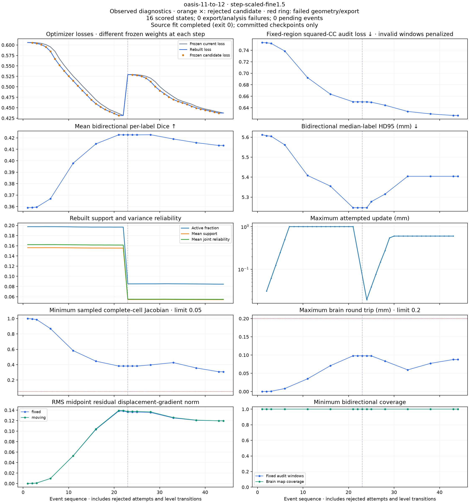

# HalfFlow checkpoint export and fine-level anatomy loss

The revised diagnostic capture reproduces the original control exactly while
moving checkpoint export out of fitting. Separately, the completed scoring of
one timed-out trajectory shows that fine refinement can improve both intensity
objectives while worsening anatomical overlap. Neither finding qualifies
HalfFlow or establishes an anatomical improvement.

This is HFQ-D01 evidence for Mote `bd-01M4X4DY7DQCVK33MCK3T17NA1`.
The [evidence manifest](evidence/halfflow-deferred-capture-20261014/artifact-manifest.json)
retains protocols, receipts, failed attempts, source patches, checks and figures.
Large MRI and map arrays remain local with recorded hashes.

## Capture neutrality

The original synchronous-export panel ended with one successful fit, two
one-hour timeouts and seven explicit cancellations. Its entire attempt ledger
remains in the [objective-probe archive](halfflow-objective-probe-v1.md).
The replay retains the same five pairs, two existing policies, checkpoint
selection, 24-state budget and one-hour per-fit deadline.

An explicit `--checkpoint-defer-export true` option writes raw midpoint maps,
validity, affine factors and scalar events during optimization. Each saved state
is marked as awaiting export. Ordinary final export and admission still occur
inside the fit deadline. Offline checkpoint exports have their own frozen
inputs, process measurements, deadlines and receipts in a separate directory.

Before expanding the replay, the OASIS 11 → 12 selected control passed the
[complete neutrality check](evidence/halfflow-deferred-capture-20261014/trajectories-deferred-v2/neutrality-verification.json):

- All 30 scalar events and capture selections agree exactly.
- All 13 raw states agree exactly across 130 saved artifacts.
- All 15 compared final files agree exactly, including optimizer diagnostics,
  both native pull maps, validity, warped images and residual maps.
- All 20 offline-export artifacts agree exactly across the original coarse-start
  and fine-start checkpoints, including native admission status and diagnostics.

The fit exited successfully after 1,196.27 diagnostic wall seconds. Concurrent
work makes this unsuitable for a runtime comparison. Its optimizer still ends
with the original accepted-step budget/controller exhaustion behavior; this
replay does not turn that behavior into convergence.

## Independent scoring after offline export

The separate scoring path now verifies the frozen capture, export engine,
raw-state inputs, per-export receipt, output hashes and native admission before
using an offline map. Admission comes from the export result; the raw capture's
"deferred" status does not admit a map. A pending export receives no score,
while process failure, construction failure and geometric rejection remain
distinct. The analysis protocol retains every selected source fit, including
failed fits with no events. An exported checkpoint cannot change its source
fit's outcome.

Eleven focused provenance and failure tests pass. On the original coarse-start
and fine-start real checkpoints, the
[scoring parity check](evidence/halfflow-deferred-capture-20261014/offline-scoring-supplement-v1/offline-analysis-parity-v1/parity-verification.json)
reproduces all regularity, fixed-intensity, geometry and anatomy numbers exactly.
All six complete evaluation, per-structure and sampled-cell reports are
byte-identical. Only elapsed audit times and relocated paths to identical
hashed inputs are excluded from numerical equality. All 30 original scalar
events remain represented: two scored states, 17 uncaptured events and 11
states outside the explicitly limited parity-export plan.

The OASIS 11 → 12 step-scaled replay has also completed, retaining 16 raw
checkpoints and matching all four historical final map/validity files exactly.
Its successful process exit does not establish optimizer convergence. A frozen
first batch now includes every captured state from both OASIS 11 policies:
29 separate export attempts followed by independent scoring. Explicit terminal
fit batches allow this work to proceed while other fits run; omitted panel fits
remain outside the batch and in the full panel's original denominator.

The [scoring supplement](evidence/halfflow-deferred-capture-20261014/offline-scoring-supplement-v1/artifact-manifest.json)
archives the completed parity evidence, tests, helper sources, source-fit
receipts and immutable first-batch declarations. It does not claim that this
29-state batch or the full ten-fit panel has completed. Two orchestration launch
errors are also retained; neither started a scoring or export process.

## Preserved failures and correction

The first offline-export attempt failed exact parity on both checkpoints.
Maximum forward-coordinate differences were `1.09e-12` and `1.35e-12` mm;
backward maps and validity were unchanged. The original midpoint initializer
constructs affine arms as `(root.inverse, root)`. The canonical affine stores
both directions, so independently re-inverting the serialized fixed arm loses
the exact cached root through floating-point rounding.

The corrected loader reconstructs the original pair from the moving root and
requires exact agreement with every saved fixed-arm coefficient. An inconsistent
pair is rejected. Both checkpoint exports then pass byte equality without a
tolerance change. A focused regression checks both cached affine directions;
the grid test also checks oblique coefficients and the native live frame owner.

The initial ten runner/loader/grid checks passed; both focused affine/grid
checks passed after the correction. The archive also retains an sbt launch
failure caused by cache permissions and an aborted freeze caused by the Git
file list exceeding Node's default output buffer. Increasing that buffer changes
neither source selection nor registration numerics.

## A fixed intensity audit can improve while anatomy worsens

All 42 committed events from the original OASIS 11 → 12 step-scaled run have
analysis receipts. Fourteen states were captured and scored; every scored state
passes the current native/common geometry and sampled-cell checks. The source
fit timed out and remains a failed fit. Its incomplete, uncommitted step-20
directory is not promoted to a captured state or a final result.

| Fine accepted steps | Optimizer rebuilt loss ↓ | Independent fixed-audit loss ↓ | Mean bidirectional Dice ↑ | HD95 (mm) ↓ |
| ---: | ---: | ---: | ---: | ---: |
| 0 | 0.529247 | 0.650371 | 0.422652 | 5.246936 |
| 1 | 0.528819 | 0.650137 | 0.422615 | 5.246936 |
| 2 | 0.527537 | 0.649676 | 0.422617 | 5.277353 |
| 5 | 0.512420 | 0.644460 | 0.422738 | 5.315000 |
| 10 | 0.469591 | 0.633549 | 0.419009 | 5.404319 |
| 15 | 0.449892 | 0.629331 | 0.415789 | 5.404319 |

The independent audit retains its fixed target masks and window population;
both directions have full window coverage at these states. Its loss improves
alongside the optimizer loss while Dice declines after step 5. Changing
optimizer weights alone therefore cannot explain this case's anatomical loss.
The lower displacement-gradient norm during fine refinement also cautions
against simply describing this as excessive deformation complexity.

The [per-structure figure](evidence/halfflow-deferred-capture-20261014/partial-step-scaled-figures-v2/per-structure.png)
retains all 62 labels in both directions. These observed labels diagnose the
trajectory; they do not select a stopping point or an output for deployment.
This single partial trajectory does not establish a population-level effect.

The [full partial-panel scoring supplement](evidence/halfflow-deferred-capture-20261014/partial-panel-analysis-supplement-v1/artifact-manifest.json)
now accounts for all 124 committed events across the original ten fit attempts:
47 captured states were scored and 77 events requested no retained state.
There are no analysis/export-unavailable failures among those committed states;
all 47 pass the current common geometry and sampled-cell checks. The two timed-out
and seven cancelled fits retain their original failed outcomes. Five cancelled
fits produced no committed events and remain in the fit-attempt denominator.

## Reproduction and remaining work

The archive contains independently verified source patches against the frozen
D01 engine. Reconstruct that engine from P01's `control-source.tar.gz` plus the
[D01 instrumentation patch](evidence/halfflow-diagnostics-pilot-20261014/instrumentation.patch),
then apply the appropriate new patch. The capture build is
`57e03c8b5d3f0af6f65c38e3603f811292c1715065b8127afc12b1e9f8884ad6`;
the corrected offline-export build is
`a2b5ddf1ce9da82ed4f4b59ee9aa488466baf69a264d46938cb962cf188d146a`.
They have separate frozen classpaths and manifests.

Use `trajectory_study.py freeze --prior-study ...` for deferred capture,
`export_engine.py` for a separate offline build, `offline_checkpoints.py` for
export receipts and `verify_deferred.py` for exact pilot neutrality. Use fresh
directories and the pinned Python/Scala environments. Captures, failed attempts
and published archives are not overwritten.

For a terminal fit batch, repeat `offline_checkpoints.py freeze --fit pair/policy`.
Freeze its scorer with `checkpoint_analysis.py freeze --offline-exports ...`,
then run the scorer as exports finish. It skips pending exports without writing
terminal analysis receipts; rerunning scores those states once their receipts
exist. `verify_offline_analysis.py` reproduces the two-state scientific-score
parity check. The full panel denominator remains defined by the trajectory
protocol, independently of batch boundaries.

The remaining declared replays are running sequentially. Full offline export,
scoring and review of that panel remain required for D01. The separate
[derivative-chain investigation](halfflow-intensity-chain-v1.md) localizes the
pilot's discrepancy to spatial/composition differentiation; its broader checks
remain open, and a corrected derivative alone has not yet been shown to improve
anatomy. No fresh qualification data, new optimizer policy or relaxed geometry
threshold was used here.

## Exact event accounting and the next offline batch

`verify_offline_ledger.py` checks the complete expected event identities, their
committed capture metadata, preserved source-fit outcomes, export receipts,
map hashes and admission status. It also compares the final export ledger with
every individual attempt receipt. A matching event count alone cannot establish
completion: four regression tests cover missing, duplicated, substituted and
mutated events. `--require-complete` exits 2 for incomplete accounting; export
failures and rejected maps remain explicit even when accounting is complete.

The [real-data completion-gate checks](evidence/halfflow-deferred-capture-20261014/offline-ledger-supplement-v1/runtime-verification-v1/artifact-manifest.json)
also pass: the completed two-state parity pilot accounts for all 30 events and
exits 0, while the still-incomplete 74-event batch exits 2 under
`--require-complete`. The pilot explicitly retains its 11 captured states
outside that two-state export plan, rather than counting them as scored.

The [recorded partial audit](evidence/halfflow-deferred-capture-20261014/offline-ledger-supplement-v1/verification/partial-verification-v2.json)
contains 55 of 74 expected OASIS 11 events: 10 scored checkpoints and 45 events
without captured states. It records 19 missing events and no terminal export
ledger. This timestamped snapshot is incomplete, and does not describe a final
scientific result. Its receipt hashes preserve exactly which events were checked.

The next [export declaration](evidence/halfflow-deferred-capture-20261014/offline-ledger-supplement-v1/offline-panel-oasis13-mmrr11-v1/protocol.json)
and [analysis declaration](evidence/halfflow-deferred-capture-20261014/offline-ledger-supplement-v1/offline-analysis-oasis13-mmrr11-v1/protocol.json)
cover both policies for OASIS 13 → 14 and MMRR 11 → 12. All four source fits
terminated with exit 0. Every captured state is included: 61 exports from
162 total events, with the other 101 explicitly uncaptured. Source exit 0
does not establish convergence. The batch is prepared for sequential export
after the [isolated reference timing study](halfflow-reference-audit-v1.md#declared-isolated-regularized-cost-study),
which itself waits for the current workers to finish. No outcomes from this next batch are included in
the [supplement](evidence/halfflow-deferred-capture-20261014/offline-ledger-supplement-v1/artifact-manifest.json).

## Nine-fit scalar loss snapshot

The [timestamped scalar snapshot](evidence/halfflow-deferred-capture-20261014/scalar-loss-snapshot-v1/summary.json)
contains nine terminal fits of the ten declared attempts. All nine exited 0.
OASIS 17 → 18 step-scaled was still pending when the snapshot was taken; its
live stream is excluded. Eight terminal fits have historical map baselines:
all four final map/validity hashes match exactly for each. OASIS 1 → 10
step-scaled has no historical baseline and is not counted as an exact replay.
These are diagnostic fits; exit 0 does not establish convergence.

For every accepted step, let `before` be its frozen current loss, `candidate`
its loss under the same frozen objective, and `after` its loss after rebuilding
support and weights. The new scalar accounting verifies, separately for each
pyramid level:

`sum(before − candidate) − sum(after − candidate) = initial − final rebuilt loss`

It checks every event's identity and accepted-state continuity, including
unchanged states after rejection. The nine streams contain 280 accepted updates
and 24 rejected attempts. Fourteen levels terminate at their accepted-step
budget; four fine levels exhaust the controller with no accepted update. None
of those termination reasons establishes convergence.

| Pair and policy, fine level | Accepted updates | Frozen trial loss drop, summed | Rebuild loss change, summed | Net rebuilt loss drop |
| --- | ---: | ---: | ---: | ---: |
| OASIS 11, control | 0 | 0 | 0 | 0 |
| OASIS 11, step-scaled | 20 | 0.098087 | +0.006215 | 0.091872 |
| OASIS 13, control | 20 | 0.111801 | −0.002533 | 0.114333 |
| OASIS 13, step-scaled | 20 | 0.111278 | −0.002359 | 0.113637 |
| MMRR 11, control | 0 | 0 | 0 | 0 |
| MMRR 11, step-scaled | 20 | 0.105562 | +0.000373 | 0.105189 |
| OASIS 1, control | 0 | 0 | 0 | 0 |
| OASIS 1, step-scaled | 20 | 0.101549 | +0.001635 | 0.099914 |
| OASIS 17, control | 0 | 0 | 0 | 0 |

Positive rebuild change offsets frozen trial improvement. The complete summary
also retains all nine coarse levels, population counts, support mass, active
windows, variance statistics and stabilization mass.

One of the 280 accepted updates increases the rebuilt loss: OASIS 13 control,
fine-level update 1 (event 24). Its frozen loss decreases from
`0.530643266102` to `0.530558147031`, but its rebuilt loss is
`0.530876225932`. This is a frozen improvement of `0.000085119071`, followed
by a rebuild increase of `0.000318078901`, giving a net increase of
`0.000232959830`. The state was captured; its new offline anatomical scoring is
in the next export batch. The later net loss decrease for this level does not
erase that accepted increase.

Most accumulated scalar loss improvement survives rebuilding on these streams.
That arithmetic does not establish a common voxel population or show that
removing difficult voxels caused an anatomical decline. Positive-support counts
decrease at 168 accepted updates, but counts alone do not identify which voxels
changed. Fixed-region intensity audits and anatomical trajectories remain
necessary; the already observed intensity/anatomy disagreement is not resolved.

Three regression checks cover rebuild penalties and accepted increases,
explicit partial levels, and missing events or inconsistent accepted states.
The [archive](evidence/halfflow-deferred-capture-20261014/scalar-loss-snapshot-v1/artifact-manifest.json)
contains the verified terminal receipts, compressed scalar streams and logs,
source hashes, summarizer and passing check log. It contains no MRI or dense-map
payloads. `summarize_scalar_losses.py` reproduces the calculation from the sealed
study; later snapshots must use a new directory and preserve this partial one.

## Completed capture panel and first scored batch

The [complete scalar ledger](evidence/halfflow-deferred-capture-20261014/scalar-loss-complete-v1/summary.json)
now contains all ten declared fits, each exiting 0: 384 scalar events,
320 accepted updates and 24 rejected attempts. Sixteen levels end at their
accepted-step budget and four exhaust the controller. These are completed
diagnostic runs, not converged registrations. Eight fits have historical map
baselines and replay all four final map/validity hashes exactly. The OASIS 1 and
OASIS 17 step-scaled fits have no historical baseline. The earlier nine-fit
snapshot is preserved unchanged.

The full panel still has one accepted rebuilt-loss increase, the OASIS 13 event
described above. Positive-support counts decrease at 199 accepted updates. The
same caution about changing voxel populations applies.

The first offline batch is complete. Its
[exact ledger verification](evidence/halfflow-deferred-capture-20261014/completed-oasis11-v1/ledger-verification.json)
accounts for all **74 OASIS 11 events: 29 scored states and 45 uncaptured events**.
Every declared export has its terminal receipt. The 29 scored states comprise
13 control states and 16 step-scaled states, including the selected rejected
candidates. All 29 pass native export admission, independent geometry and
sampled complete-cell checks; no export or analysis failed. This does not
establish convergence or certify the unresolved full boundary contract.

| OASIS 11 step-scaled fine state | Rebuilt optimizer loss | Fixed-region audit loss | Mean bidirectional Dice | Median-label HD95 (mm) |
| --- | ---: | ---: | ---: | ---: |
| Start | 0.529247 | 0.650371 | 0.422652 | 5.246936 |
| Accepted 5 | 0.512420 | 0.644460 | 0.422738 | 5.315000 |
| Accepted 10 | 0.469591 | 0.633549 | 0.419009 | 5.404319 |
| Accepted 15 | 0.449892 | 0.629331 | 0.415789 | 5.404319 |
| Accepted 20 / endpoint | 0.437375 | 0.626561 | 0.413321 | 5.404319 |

The completed endpoint extends the earlier partial negative result: fine
refinement improves both intensity losses while worsening anatomy. Its
midpoint displacement-gradient RMS also decreases during fine refinement, so
a claim that greater deformation roughness alone explains this decline is not
supported by that scalar regularity measure. This is one observed pair, not a
cross-cohort causal conclusion. The control accepts no fine update; its scored
rejected candidates worsen both the independent intensity audit and anatomy.

The endpoint decline is distributed across structures: averaging the two
directions for each of the same 62 labels, 45 lose Dice and 17 gain it between
fine start and fine end. HD95 worsens for 34 labels, improves for 20 and ties
for eight. No label is removed or used to choose the returned checkpoint.

The [complete archive](evidence/halfflow-deferred-capture-20261014/completed-oasis11-v1/artifact-manifest.json)
retains every compact event, export receipt and scientific report, both full
trajectory plots and per-structure plots. MRI and dense maps remain local with
verified identities. `archive_completed_offline.py` requires the exact ledger
to be complete before producing this archive. At that snapshot, the next
61-state export batch was unstarted, pending the isolated timing window.

## Anatomy batch moved ahead of timing

The [prospective scheduling amendment](evidence/halfflow-deferred-capture-20261014/offline-before-timing-v1/amendment.json)
moves the already-declared OASIS 13 and MMRR 11 batch ahead of P02 timing.
The 22:15 UTC process check still found nine external numerical workers.
Waiting for isolation was therefore delaying untimed anatomical evidence.
The frozen timing protocol prohibits concurrent numerical work during timing;
it does not require these exports to occur afterward. Its original bytes and
all earlier evidence remain unchanged.

This batch contains **61 captured states and 162 scalar events across four
terminal fits**. The supervisor starts one export worker and one scoring worker
using the previously sealed protocols. No fitting, capture selection, input,
evaluator, threshold or denominator changes. Scoring preserves the 101
uncaptured events explicitly. Both workers must exit successfully and the exact
61-export/162-event ledger must be complete before the amended timing launcher
permits a run. A partial or failed batch blocks timing. Eight process-monitor
and scheduling checks pass, including a first export that has started but has
not yet produced a terminal receipt.

The batch is running; this declaration contains no completed-batch conclusion.
Its times are excluded from performance comparisons. The remaining
representative-success trajectories on OASIS 1 and OASIS 17 also need offline
scoring before D01 can close. The corrected-direction screen remains gated;
no new anatomical improvement or convergence is established by scheduling work.
