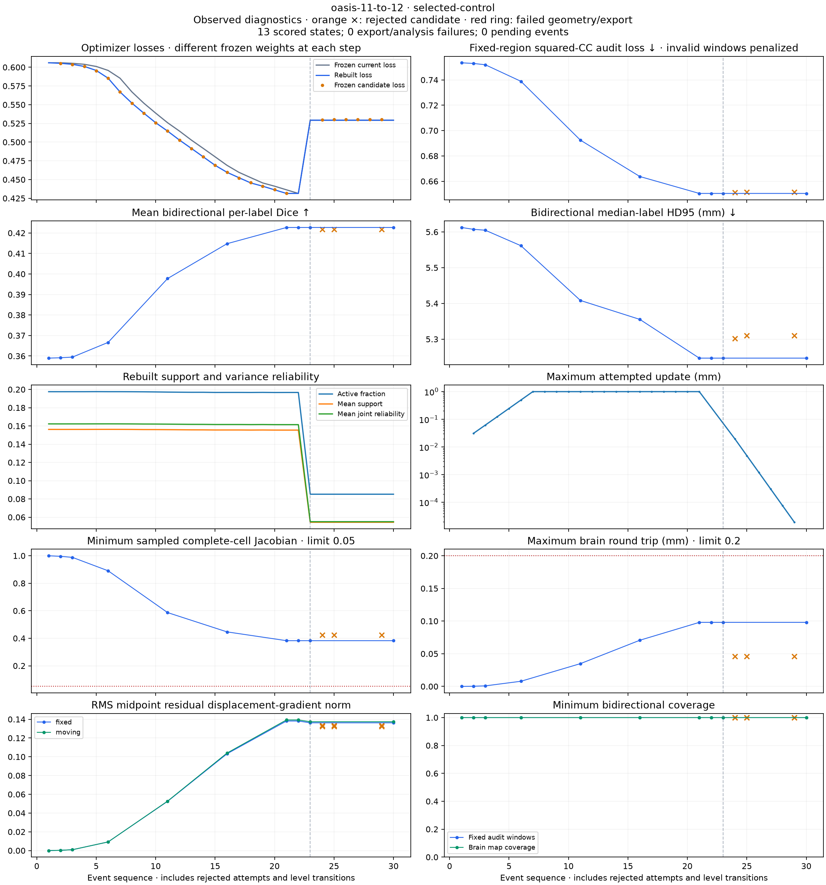
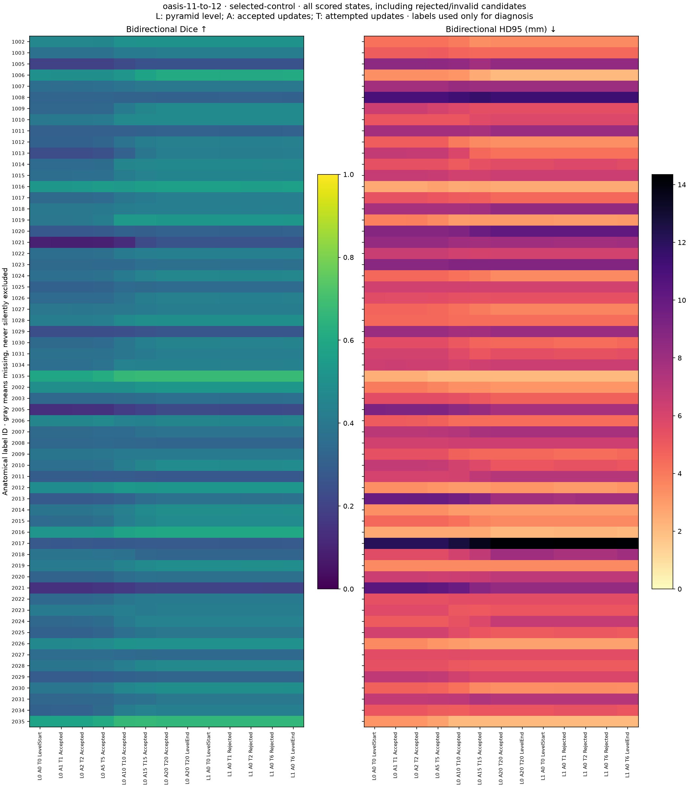
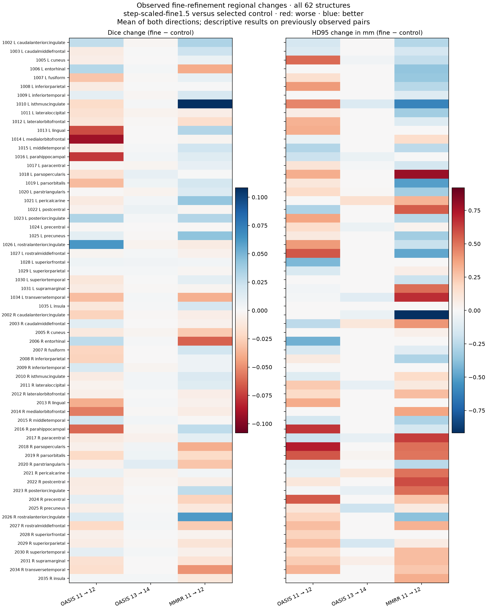

# HalfFlow checkpoint diagnostics: verified pilot, partial panel

The first acquired-image replay verifies that bounded checkpoint capture
preserves the selected HalfFlow result exactly on OASIS 11 → 12. Both final
coordinate arrays and validity arrays are byte-identical to the frozen control.
The final captured checkpoint also matches all eight ordinary export artifacts
in both directions, including warped values and map metadata. This validates
the instrumentation on one acquired pair; it is not evidence of improved
registration accuracy or completed qualification.

This is HFQ-D01 (`bd-01M4X4DY7DQCVK33MCK3T17NA1`) under the
[qualification contract](halfflow-qualification-protocol-v1.md). The remaining
nine declared case/policy replays ended with two diagnostic timeouts and seven
explicit cancellations. All 13 pilot checkpoints have completed independent
scoring; partial captures from the other attempts are scored separately.
The [objective-probe follow-up](halfflow-objective-probe-v1.md) records the complete
attempt ledger. The [deferred-export follow-up](halfflow-deferred-capture-v1.md)
implements that redesign, verifies exact pilot neutrality and reports the
committed step-scaled trajectory's intensity/anatomy divergence. A new sealed
panel replay is running. D01 and the qualification epic remain open.

## Capture and independent checks

The opt-in observer records scalar diagnostics at every attempt and level
boundary. It retains the frozen trial objective separately from the freshly
rebuilt objective, support/variance summaries, controller transitions,
termination and candidate availability. Requested states have detached
coordinate and validity buffers. A rejected candidate remains a diagnostic
artifact and cannot replace the optimizer's current state. Observer I/O failures
propagate as failures.

The declared captures are level starts/ends, accepted updates 1, 2, 5, 10, 15
and 20, and rejected absolute attempts 1, 2 and 6. A hard budget of 24 states
spans all levels. Raw midpoint fields retain their original pyramid grids;
separate copies are regridded to the prepared native lattices for export and
common scoring. Every scalar event remains visible when a state is not
requested, unavailable or exceeds the capture budget.

The pilot records 30 events and 13 states. It reproduces 20 accepted coarse
updates, zero accepted fine updates, and six rejected fine attempts before
controller exhaustion. Its
[independent artifact verification](evidence/halfflow-diagnostics-pilot-20261014/trajectories-v1/oasis-11-to-12/selected-control-checkpoint-verification.json)
passes event/counter/objective continuity, captured-record identity, raw array
sizes and hashes, rejection-state checks, and final export equality.
Budget/controller termination still does not establish convergence.

Affected checks pass: 38 JVM tests, eight acquired-image runner tests, 21
Scala.js tests, four fixed-audit tests, two physical-regularity tests and two
resume-gate tests. The archive retains the initial sandbox launcher failure
and fatal-warning build failure alongside the subsequent passing checks.

## Declared diagnostic panel

The five observed pairs are OASIS 11 → 12, OASIS 13 → 14, MMRR-21 11 → 12,
OASIS 1 → 10 and OASIS 17 → 18. The first three reproduce earlier refinement
sentinels; the last two are predeclared examples where selected HalfFlow
improved bidirectional Dice and HD95 over the saved affine. Each pair compares
the existing selected control with the existing `step-scaled-fine1.5` policy.
No new optimizer policy or fresh qualification subject enters this panel.

After the pilot passed, a
[prospective scheduling amendment](evidence/halfflow-diagnostics-pilot-20261014/trajectories-v1/execution-parallel-v1/protocol.json)
declared two independent diagnostic jobs for the remaining nine combinations.
Each retains one active Java processor, a 6 GiB heap and a one-hour deadline.
Numerical classes, data, affines, policy flags, capture points and geometry
limits are unchanged. All failed attempts remain in the ledger.

This version of the panel subsequently ended with two one-hour timeouts during
synchronous checkpoint capture. The remaining seven jobs were cancelled with
their normal failed-fit receipts retained. The next revision will persist raw
states during fitting and perform per-checkpoint export afterward; it has not
yet established complete trajectories for the remaining combinations.

The pilot took 1,874 seconds with approximately 5.09 GiB peak child RSS.
Checkpoint export dominates this diagnostic overhead. These times, and all
overlapping diagnostic jobs, are excluded from production performance
comparisons; the controlled [reference cost study](halfflow-reference-audit-v1.md)
remains separate.

## Common checkpoint scoring

The intensity audit was sealed before any checkpoint score was examined. It
uses every voxel of each fixed target brain mask on the original prepared
lattice, a fixed 3 mm box-window radius and target-only variance stabilization.
Invalid windows receive squared-CC loss 1; they cannot disappear from the
denominator. Both directions retain center/window coverage, nonfinite counts
and exact input identities. This score is diagnostic and does not enter fitting
or stopping.

Each captured map is also evaluated for native export status, unchanged
independent geometry and sampled complete-cell Jacobians, bidirectional
per-structure Dice/HD95, and physical midpoint displacement-gradient norms.
Original captured files remain inputs; derived reports occupy a separate
analysis tree. Uncaptured states, failed exports and analysis failures remain
explicit. All 13 pilot states pass native export, independent geometry and
sampled complete-cell checks, with complete anatomical scores. The other
17 scalar events have no requested capture; none is an analysis failure.
Label-based checkpoint ranking is never a runtime selection rule.

| Pilot state | Bidirectional mean Dice | HD95 | Fixed-region CC loss |
| --- | ---: | ---: | ---: |
| Initial affine | 0.358973 | 5.612486 mm | 0.753527 |
| Coarse end / fine start | 0.422683 | 5.246936 mm | 0.650397 |
| Fine rejected attempt 1 | 0.421785 | 5.302240 mm | 0.651135 |
| Fine rejected attempt 2 | 0.421716 | 5.309896 mm | 0.651301 |
| Fine rejected attempt 6 | 0.421720 | 5.309896 mm | 0.651356 |
| Final retained state | 0.422683 | 5.246936 mm | 0.650397 |

Coarse refinement improves anatomy and the fixed-region intensity audit.
Every captured fine candidate slightly worsens all three measures despite
passing geometry. Rejecting these candidates is therefore supported by the
independent audit on this pair. None of the 20 accepted coarse updates increases
the rebuilt optimizer loss relative to its preceding current loss.

At the coarse-to-fine transition, optimizer loss changes from 0.431497 to
0.529267 while the exported maps, anatomical scores and fixed-region audit
remain unchanged. Support summaries also change substantially. This establishes
that optimizer loss is not directly comparable across these levels; it does
not establish that the support change is defective.

An [independent support reconstruction](evidence/halfflow-diagnostics-pilot-20261014/support-transition/result.json)
reproduces both positive-support counts exactly and both support sums within
2.5 × 10⁻⁹ (declared tolerance 10⁻⁷). At the fine level, the fixed input mask
occupies 365,983 of 2,276,640 voxels. Trilinear interpolation requires every
contributing source voxel to be valid, leaving 290,387 warped valid locations;
the one-voxel safety margin leaves 149,189, or about 6.6% of the grid. The
mask-normalized coarse pyramid admits locations with Gaussian weight at least
10⁻⁸, expanding the valid mask; about 15.9% of its grid survives the safety
margin. The frozen runner also supplies the fixed image mask while constructing
the moving image with default full-grid validity. Moving validity does not
further restrict the joint support in these two checkpoints. These are confirmed
population and input-handling differences, not yet a causal explanation of the
anatomical regression. D02 must test image order and pyramid consistency.

The rejected-state comparison finds an approximately 0.265 mm maximum fixed-arm
endpoint change for each of fine attempts 1, 2 and 6, even as the attempted
velocity maximum falls from 0.019401 mm to 0.000018946 mm, a factor of 1,024.
Raw lattice validity is unchanged. This nonvanishing candidate change is
consistent with the selected policy's fixed accumulated-smoothing step; shrinking
the velocity alone does not make the whole proposal approach the current state.
The existing step-scaled policy addresses that continuity problem, but its
historical anatomical regressions below prevent treating continuity as a
sufficient solution to fine refinement.

## Existing regional evidence

A separate descriptive analysis retains every structure from the previously
completed sentinel reports. Changes below are `step-scaled-fine1.5` minus the
selected control; HD95 is the mean of the two direction-wise median-label
values.

| Observed pair | Mean Dice change | HD95 change | Regions losing bidirectional Dice | Regions with higher bidirectional HD95 |
| --- | ---: | ---: | ---: | ---: |
| OASIS 11 → 12 | −0.009362 | +0.157383 mm | 45/62 | 33/62 |
| OASIS 13 → 14 | +0.000584 | 0.000000 mm | 29/62 | 7/62 |
| MMRR-21 11 → 12 | +0.002096 | +0.111216 mm | 32/62 | 28/62 |

OASIS 11 → 12 shows broad deterioration, including bidirectional Dice drops
of 0.091968 in left medial orbitofrontal cortex, 0.076396 in left
parahippocampal cortex and 0.070278 in left lingual cortex. Region names follow
the [official FreeSurfer lookup table](https://raw.githubusercontent.com/freesurfer/freesurfer/dev/distribution/FreeSurferColorLUT.txt);
the retrieved mapping and content hash are retained. These regional
associations do not identify a causal mechanism. In particular, Dice and
surface distance can move in different directions within a region.

## Reproduction and evidence scope

The [pilot artifact manifest](evidence/halfflow-diagnostics-pilot-20261014/artifact-manifest.json)
contains compact receipts, logs, source/input/class identities, scalar events
and hashes of the retained large arrays. It explicitly records one completed
combination out of ten and does not represent the unfinished panel as complete.
Source MRI volumes, label volumes and coordinate arrays remain local.

A separate [scoring supplement manifest](evidence/halfflow-diagnostics-pilot-20261014/scoring/artifact-manifest.json)
adds all 30 event receipts, 13 independently scored states, reviewed trajectory
and per-structure plots, and the rejected-state displacement comparison.
It preserves the initial manifest unchanged and binds its identity. It still
covers only the pilot, not the remaining nine combinations.

The exact experimental implementation is reproducible from P01's
[frozen source archive](../../benchmarks/halfflow/qualification/control-source.tar.gz)
plus the verified
[six-file instrumentation patch](evidence/halfflow-diagnostics-pilot-20261014/instrumentation.patch).
The [source-delta receipt](evidence/halfflow-diagnostics-pilot-20261014/source-delta.json)
records successful scratch reconstruction of every changed source hash. Apply
these in an isolated checkout; do not overwrite a working source tree. The
diagnostic prototype's library/API integration remains separate unfinished work.

On the original data host, use the pinned Python environment and frozen
classpath. The scripts under
[benchmarks/halfflow/diagnostics](../../benchmarks/halfflow/diagnostics/)
provide the study freeze/run, scheduling amendment, artifact verifier,
checkpoint analysis and plots. Existing protocols, attempts and receipts must
not be overwritten. All new runs require fresh directories and their own seals.

Anatomical annotations derive from Mindboggle-101: Klein and Tourville,
*101 labeled brain images and a consistent human cortical labeling protocol*,
Frontiers 6:171 (2012), [doi:10.3389/fnins.2012.00171](https://doi.org/10.3389/fnins.2012.00171).
The cortical label release uses CC BY 4.0; original MRI access retains its
source terms. This archive distributes derived summaries and program source,
not the source images or label volumes.
