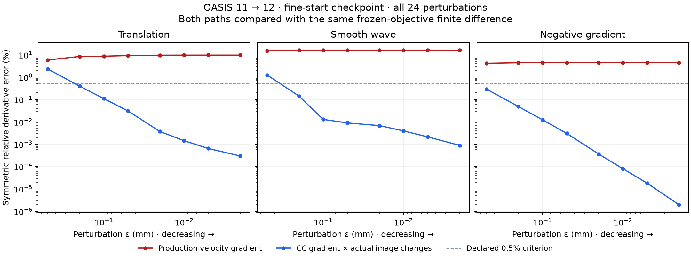

# HalfFlow acquired-image derivative-chain isolation

At the verified OASIS 11 → 12 fine-start checkpoint, CC's intensity derivatives
agree with finite differences through the actual sampled-image changes. The
production velocity gradient still fails the declared accuracy criterion.
This localizes the measured discrepancy to the spatial/composition part of the
gradient chain on this checkpoint. It does not identify a complete remedy or
demonstrate improved anatomical registration.

This extends the [original objective probe](halfflow-objective-probe-v1.md) under
HFQ-D01 and informs HFQ-D02 (`bd-01M4X4DYCNRG58VQVKJKH77WWR`). The
[evidence archive](evidence/halfflow-intensity-chain-20261014/artifact-manifest.json)
contains the declaration, all 24 perturbations, receipts, tests, source patch and
figure. No fresh qualification data or new optimizer policy was used.

## Controlled comparison

The checkpoint, images, validity, frozen support/reliability/variance weights,
three directions and eight perturbation sizes are unchanged. Both signs of each
perturbation use the production paired integration, residual composition,
affine/grid sampling and CC objective. The original production-gradient dot
product and every original finite-difference loss/error are reproduced exactly.

The additional diagnostic takes CC's frozen intensity gradients and forms

`[dL/dF · (F+ − F−) + dL/dM · (M+ − M−)] / (2ε)`.

Here `F±` and `M±` are the actual candidate warped images. This isolates CC's
intensity differentiation from the spatial derivative approximation without
substituting a different interpolation implementation. It is a diagnostic
comparison, not a new velocity-gradient implementation.

Both derivative paths use the previously declared symmetric relative error:
`abs(a − b) / max(1e-12, abs(a) + abs(b))`. Passing requires a minimum error at
most 0.005 and a region of at least three consecutive decreasing errors across
the declared epsilon sequence.

| Direction | Production error at ε = 0.002 mm | Intensity-chain error at ε = 0.002 mm | Intensity-chain criterion |
| --- | ---: | ---: | --- |
| Tapered translation | 9.6975% | 0.0002991% | Pass |
| Smooth wave | 16.0727% | 0.0008943% | Pass |
| Negative production gradient | 4.4850% | 0.000001973% | Pass |

The intensity chain passes for all three directions and has a decreasing-error
region in each. The production gradient fails all three original criteria;
even its best errors across the eight sizes remain approximately 5.9%, 15.0%
and 4.2%. Signs agree, so the experiment does not demonstrate an ascent direction.

## Interpretation and limits

The production path multiplies CC intensity derivatives by central physical
differences of the already-warped images. The actual perturbation composes the
midpoint maps and then samples the prepared source images through the affine
and grid transforms. Those two calculations are not interchangeable in this
acquired-image case. Agreement of the intensity-chain diagnostic with the full
objective supports investigating the spatial/composition chain before changing
CC's intensity-gradient algebra.

This is one checkpoint, one image ordering and one grid configuration, before
accumulated regularization. Exact interpolation derivatives, residual-map
Jacobians, boundary behavior, image-order symmetry and mixed/oblique grids still
need controlled checks. The earlier fixed-smoothing zero-step discontinuity is
a separate issue. The [partial step-scaled trajectory](halfflow-deferred-capture-v1.md)
also shows intensity improvement alongside anatomical loss, so a numerically
correct gradient alone is not yet an anatomical solution.

The probe retains detached gradient and initial-image buffers and does not
modify optimization. Three focused tests pass on JVM and Scala.js, including
production-initialization parity, frozen-state preservation, candidate frame
admission and convergence of the sampled-intensity diagnostic. The acquired-image
runner compiles; its 24 samples complete with the original current loss unchanged.

## Reproduction

The frozen numerical source is
`9c223081759c599574ba1c1bab82fe39f24dc0e112979325b0ed207900e0c475`.
The archive's source patch reconstructs it from the D01 frozen engine, whose
reproduction chain is P01's `control-source.tar.gz` plus the D01 instrumentation
patch. The patch is applied in a scratch directory and every changed source
identity is verified before publication.

Use the pinned environment and `objective_probe.py freeze` with
`--derivative-baseline` pointing to the original completed probe, followed by
`objective_probe.py run` in a fresh directory. The protocol and receipt preserve
input, source, build, baseline and result identities. Diagnostic wall time was
324.92 seconds with overlapping work; it is excluded from performance comparisons.
D01, D02 and the qualification epic remain open.
