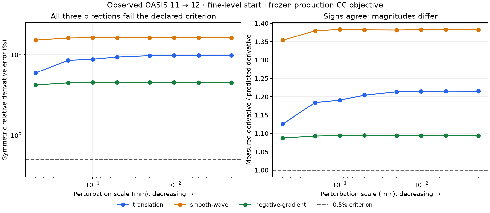

# HalfFlow acquired-image objective probe

The production velocity gradient fails the existing directional-derivative
criterion on the saved OASIS 11 → 12 fine-level start. All three predetermined
directions miss the 0.5% tolerance, despite reproducing the saved current loss
within 10⁻¹². The measured and predicted signs agree. This is a consistency gap
on one observed checkpoint, not evidence that all proposed directions ascend,
nor a completed diagnosis of anatomical regression.

The [completed receipt](evidence/halfflow-objective-probe-20261014/objective-probe-pilot-v2/receipt.json)
and [all samples](evidence/halfflow-objective-probe-20261014/objective-probe-pilot-v2/audit/result.json)
belong to the [qualification epic](halfflow-qualification-protocol-v1.md).
D01 and D02 remain incomplete. No optimizer policy is promoted.

## What was tested

The probe loads the verified diagnostic pilot's fine-start residual fields and
affine arms. It calls the production objective initialization, physical velocity
gradient and frozen candidate evaluator. Perturbations use the actual paired
integration, residual composition and image interpolation. The source images,
fixed mask, maps and saved loss retain their original identities; labels do not
enter this calculation.

The [prospective protocol](evidence/halfflow-objective-probe-20261014/objective-probe-pilot-v2/engine/protocol.json)
declares a boundary-tapered translation, a smooth wave and the normalized
negative production gradient. Each uses physical perturbation magnitudes
0.5, 0.2, 0.1, 0.05, 0.02, 0.01, 0.005 and 0.002 mm, with both signs.
The central difference is `(L(+h) - L(-h)) / (2h)`; the symmetric relative error
is `abs(measured - predicted) / max(1e-12, abs(measured) + abs(predicted))`.
The existing synthetic-test criterion requires a minimum error at most 0.005
and three consecutive entries with decreasing error.

| Direction | Best symmetric relative error | Error at 0.002 mm | Criterion |
| --- | ---: | ---: | --- |
| Translation | 5.896% | 9.698% | fail |
| Smooth wave | 15.028% | 16.073% | fail |
| Negative gradient | 4.193% | 4.485% | fail |

The frozen current loss remains unchanged after the full perturbation sequence.
The probe examines the objective before accumulated regularization; it does
not differentiate the fixed-smoothing proposal as a whole. The next isolation
must distinguish spatial-gradient approximation, interpolation, composition and
support behavior through the actual execution path, then extend to other
checkpoints, image order and physical grids. The discrepancy alone does not
establish which component is defective or that correcting it improves anatomy.

## A rejected solver hypothesis

The [initial probe receipt](evidence/halfflow-objective-probe-20261014/objective-probe-pilot-v2/audit/initial.json)
rules out rank-one saturation at this checkpoint. With damping 10⁻⁴ and loss
0.5292673434405287, the gradient-norm crossover is 0.01028851149. The largest
observed norm is only 0.00006495033710; none of 149,189 valid sites crosses it.
The quadratic term contributes at most 0.003986% of the damping term, so its
effect on the unsmoothed velocity magnitude is below 0.004% here. This finding
does not rule out smoothing, clipping, support or accumulated-regularization
effects, and does not generalize to unmeasured states.

## Diagnostic panel failure and next capture design

The original synchronous-export panel has a complete ten-combination attempt
ledger: one completed exact pilot, two one-hour diagnostic timeouts, and seven
explicitly cancelled jobs. OASIS 11 → 12 `step-scaled-fine1.5` and OASIS 13 → 14
`selected-control` each retained 42 scalar events and 14 committed captures
before timeout. Neither produced a completed final export. Their partial maps
cannot establish successful replay or qualifying convergence.

The remaining seven jobs were stopped under the recorded
[cancellation plan](evidence/halfflow-objective-probe-20261014/trajectories-v1/execution-parallel-v1/cancellation-plan-v1.json).
Only the verified dispatcher's measured child groups were signalled; the
[cancellation receipt](evidence/halfflow-objective-probe-20261014/trajectories-v1/execution-parallel-v1/cancellation-receipt-v1.json)
confirms that all seven normal failed-fit receipts were preserved. Reference
and objective-probe jobs continued.

Per-checkpoint native inverse/export work belongs outside the fitting process.
The next instrumentation revision will persist raw states during the fit and
export/score them afterward, with separate receipts and deadlines. That revision
has not yet run. The already committed partial captures are being scored under
the original sealed analysis; this report does not claim those analyses complete.
All diagnostic wall times are excluded from production comparisons.

## Checks, failures and reproduction

The new probe passes two JVM and two Scala.js checks; the observer passes six
JVM checks; the checkpoint loader passes its physical-coordinate round-trip and
mismatched-affine test. All 15 original engine tests pass with a 120-second
MUnit allowance for dense inverse/export tests. The initial 30-second timeout
is preserved alongside the passing rerun. The runner compiles.

The first real-data probe stopped before objective evaluation because its loader
compared a canonical affine wrapper with the matrix representation. The corrected
loader compares all 16 coefficients exactly. Its failed attempt, the initial
wrong-project build command and an intermediate accessor compile failure remain
in the archive. The corrected acquired-image probe completes all 24 samples in
252 seconds of diagnostic wall time.

The [artifact manifest](evidence/halfflow-objective-probe-20261014/artifact-manifest.json)
retains receipts, logs, source/input/class identities, every panel outcome and
hashes for large local arrays. The complete numerical prototype is reproduced
from P01's [source archive](../../benchmarks/halfflow/qualification/control-source.tar.gz),
the D01 [instrumentation patch](evidence/halfflow-diagnostics-pilot-20261014/instrumentation.patch),
then the corrected [six-file probe patch](evidence/halfflow-objective-probe-20261014/objective-probe-pilot-v2/source.patch).
Both the failed and corrected probe patches were applied to scratch source
copies and checked against every changed source hash. Apply them in an isolated
checkout. Library/API integration remains separate unfinished work.

No source MRI or annotation volume is redistributed. This is observed-data
diagnostic evidence and does not satisfy fresh-cohort qualification.

The [sampled-intensity follow-up](halfflow-intensity-chain-v1.md) reproduces all
24 measurements exactly and localizes this checkpoint's derivative discrepancy
to the spatial/composition chain. The [deferred-capture follow-up](halfflow-deferred-capture-v1.md)
implements and verifies the diagnostic export redesign before restarting the panel.
