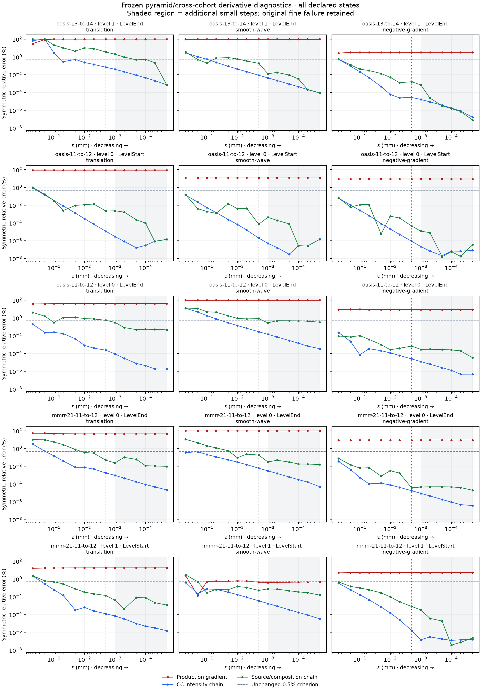

# HalfFlow derivative audit across pyramid scales

The [fine-scale spatial-chain study](halfflow-spatial-chain-v1.md) found a
production-gradient mismatch on acquired images. A diagnostic derivative of
source interpolation and residual composition agrees much more closely with
small-step finite differences, but one declared eight-step replication failed.
Its separately declared smaller-step extension passed. Those findings require
coarse-scale and cross-cohort checks before a production gradient change.

This study adds those checks using already observed development inputs. It
does not fit a new optimizer policy or consume a qualification cohort.

## Preparation and verification

`HalfFlowCc.prepareProbeLevel` delegates to the existing production pyramid
builder. It uses shared scratch sized for the larger native image, prepares
fixed then moving images, and retains independent output buffers. This preserves
the production mask-normalized filtering, downsampling and frame ownership.
The diagnostic runner rebuilds the saved work grid through the production
`pyramidGrid`, validates checkpoint shape and affine coefficients, and evaluates
the same objective, integration, composition and interpolation paths.

The new masked synthetic test captures a coarse optimizer initialization and
requires exact equality of the complete objective audit and frozen loss after
diagnostic preparation. Another test verifies that unsmoothed native-level
preparation retains the original image objects. Together with the existing
objective/spatial-chain tests, **nine tests pass on JVM and nine on Scala.js**;
both acquired-image runner tests also pass. The first fixture omitted the
required native-resolution final level and failed configuration validation.
The corrected fixture and both build logs are retained.

The new source is
`d7b5a3137d9402ea6b95eca75f384cc397b8e07d448b83d8d92442b8ed9fe429`.
Its verified delta from the smaller-step engine contains only the private
diagnostic preparation helper, its tests, and the diagnostic runner's level
selection. Optimization and derivative kernels are unchanged.

## Frozen acquired-image study

All states use the selected-control policy. Selection and input/source identities
were frozen before execution in the
[protocol](evidence/halfflow-pyramid-chain-20261014/declaration-v1/declared-protocol.json).

| Pair | Level and state | Event | Captured loss | Role |
| --- | --- | ---: | ---: | --- |
| OASIS 13 → 14 | Fine end | 44 | 0.416309794869 | Repeat the completed 42-measurement audit exactly |
| OASIS 11 → 12 | Coarse start | 1 | 0.605962639743 | Coarse initialization |
| OASIS 11 → 12 | Coarse end | 22 | 0.431496606182 | Coarse endpoint |
| MMRR 11 → 12 | Coarse end | 22 | 0.429577123704 | Cross-cohort coarse endpoint |
| MMRR 11 → 12 | Fine start | 23 | 0.482824721177 | Cross-cohort fine initialization |

The first state must reproduce all 42 prior measurements exactly. If it fails,
the remaining four states are recorded as unattempted because numerical
neutrality was not established. They are never silently dropped or replaced.
Each attempted state must reproduce its captured objective within `1e-12`.

Every attempted state uses translation, smooth wave and negative production
gradient directions, with the same boundary taper. The original eight steps
(`0.5` through `0.002 mm`) and the six additional steps (`0.001` through
`0.00002 mm`) receive separate verdicts. Both use the unchanged maximum 0.5%
minimum symmetric relative error and at least three consecutive decreasing-error
points. Spatial claims additionally require complete nonzero-derivative
support. Source interpolation knots remain explicit counts. The original failed
fine-scale replication retains its failed verdict regardless of this study.

One diagnostic worker runs each attempt with a one-hour deadline, one active
Java processor and a 6 GiB heap. Concurrent diagnostic timings do not establish
production performance. The [declaration archive](evidence/halfflow-pyramid-chain-20261014/declaration-v1/artifact-manifest.json)
contains the source patch, checks, input hashes, captured-state metadata and
source-fit/event ledgers; it contains no new study outcomes or image payloads.

## Completed outcomes

All five declared attempts completed, with **210 measurements** retained. Every
initial objective equals its captured loss exactly, and the fine control repeats
all 42 previous measurements exactly. The
[complete ledger](evidence/halfflow-pyramid-chain-20261014/outcomes-v1/results.json)
preserves the separate original-step and smaller-step verdicts. The archiver
recomputes finite differences, relative errors, convergence checks and support
counts before copying the evidence; it also verifies the frozen engine, inputs,
driver and pre-execution declaration.

| State | Spatial directions passing, original 8 steps | Spatial directions passing, additional 6 steps | Worst directional minimum error on additional steps |
| --- | ---: | ---: | ---: |
| OASIS 13 fine end, repeated control | 2/3 | 3/3 | 0.0006861% |
| OASIS 11 coarse start | 3/3 | 3/3 | 0.0000008591% |
| OASIS 11 coarse end | 2/3 | 3/3 | 0.2809414% |
| MMRR 11 coarse end | 3/3 | 3/3 | 0.0158764% |
| MMRR 11 fine start | 3/3 | 3/3 | 0.0156319% |

The source/composition chain passes **15/15 smaller-step directional checks**,
including all 12 checks at the four newly inspected states. At the original
steps it passes 13/15 overall and 11/12 at the new states. OASIS 11 coarse-end
smooth wave is the new failure: its best original-step error is **0.787886%**,
above the unchanged 0.5% limit. Its additional-step minimum is 0.280941%.
The earlier OASIS 13 fine-end translation failure remains failed at 3.589115%.
The four new states therefore pass as a group only on the additional steps.

The CC intensity chain passes all 15 directions in both ranges. The production
gradient passes 1/15 original-step checks and 0/15 additional-step checks. Its
one original-range pass is the MMRR fine-start smooth-wave direction; this is
retained even though it fails the required decreasing-error sequence on the
additional steps. At the smallest perturbation, the negative production-gradient
direction remains descent at every state. A derivative mismatch does not imply
that every existing update points uphill.

All ten arms have complete nonzero-derivative spatial support and zero counted
source interpolation knots. The fixed/moving evaluated counts are respectively
115,444/115,444; 45,815/45,815; 45,591/45,591; 36,793/36,793; and
107,967/107,969 in table order. No missing support was replaced with a zero.

The fifteen-panel plot was visually reviewed. It shows all points with a shared
logarithmic error scale; shading identifies the six additional steps and the
horizontal line marks the unchanged criterion. Several spatial curves fluctuate
or level off, especially at coarse endpoints. Passing the declared minimum-error
and decreasing-sequence rule does not establish uniformly accurate finite steps
or exact derivatives throughout an optimization trajectory. Nearby interpolation
cell crossings remain a possible explanation, not a directly measured cause.

The [outcome manifest](evidence/halfflow-pyramid-chain-20261014/outcomes-v1/artifact-manifest.json)
retains every attempt and records that the declaration archive is unchanged.
No MRI or dense-map payload is copied into this archive. This result extends the
local derivative evidence across scales and to MMRR; no optimizer policy was
changed and no anatomical benefit was tested.

## Reproduction and remaining scope

Reconstruct the smaller-step source from P01's `control-source.tar.gz`, the D01
`instrumentation.patch`, the spatial-chain `source.patch`, then
`smaller-step-outcomes-v1/source.patch`. Apply this declaration's `source.patch`
and compile with the pinned providers, Scala and Java versions.
`pyramid_chain_study.py freeze` takes the completed smaller-step study, deferred
captures and compiled classpath; `run` executes its frozen engine. Use fresh
directories and retain every failure. After all attempts terminate,
`archive_pyramid_chain.py --study /path/to/study --output /path/to/outcomes-v1`
verifies and archives them beside the pre-existing `declaration-v1` directory.

Image-order tests, broader cohorts, mixed acquired grids, boundary behavior,
regularization and controlled optimizer/anatomy comparisons remain required.
Passing this diagnostic does not establish clinical validity, competitive
registration or completion of the qualification epic. D01 and D02 remain open.
