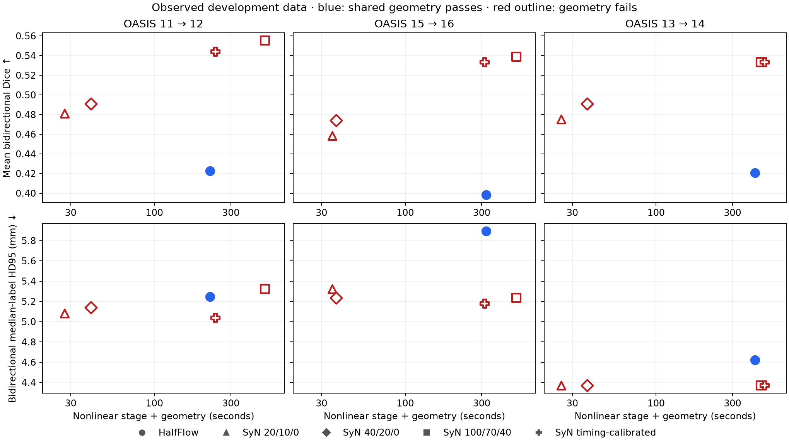

# HalfFlow and same-affine SyN reference audit

The five saved development comparisons reproduce exactly, including SyN's
anatomical advantage. The new independent geometry audit finds that all five
HalfFlow maps pass the shared checks, while all five saved SyN map pairs fail
the unchanged 0.2 mm brain round-trip limit. SyN passes the sampled cell checks
on all five. This establishes an unresolved reference-export issue; it does
not erase HalfFlow's anatomical deficit or qualify either method.

This is P02 development evidence for Mote
`bd-01M4X4DXW7WGW5WK0J3Z6PFP98`, under the
[frozen qualification contract](halfflow-qualification-protocol-v1.md).
No fresh qualification subject or result was used.

## Reproduced historical comparison

| Method | Mean bidirectional Dice | Mean bidirectional median-label HD95 | Shared geometry | Sampled cells |
| --- | ---: | ---: | ---: | ---: |
| Selected HalfFlow | 0.4190234503 | 5.2233809580 mm | 5/5 | 5/5 |
| Saved same-affine SyNOnly | 0.4876168624 | 4.9249494213 mm | 0/5 | 5/5 |

Both aggregate metrics and every pair's bidirectional metrics agree exactly
with the historical reports. The audit also rechecked all 340 historical
input identities after execution. Original reports, maps and image files were
not overwritten.

| Pair | HalfFlow maximum brain round trip | SyN maximum brain round trip |
| --- | ---: | ---: |
| OASIS 11 → 12 | 0.098041 mm | 0.435439 mm |
| OASIS 1 → 10 | 0.093971 mm | 0.657667 mm |
| OASIS 15 → 16 | 0.062314 mm | 0.685232 mm |
| OASIS 13 → 14 | 0.115117 mm | 0.459276 mm |
| OASIS 17 → 18 | 0.100574 mm | 0.533494 mm |

There are zero sampled folded cells and complete brain sampling/round-trip
coverage in all ten outputs. Minimum sampled cell Jacobians range from
0.274409 to 0.382608 for HalfFlow and 0.176240 to 0.297777 for SyN. Checks cover
all complete cells at their corners and centers. They do not prove continuous
invertibility or resolve HalfFlow's separate full-boundary inverse issue R02.

The historical selected HalfFlow source is
`44823c325ffb7ac9b9c1b99e1284b0efa63aeb201b7ec626d625acd57431b8f5`.
The controlled replay below uses P01's separately frozen current executable;
its identity is in the [control seal](../../benchmarks/halfflow/qualification/control-seal.json).
Neither run is substituted for the other in historical evidence.

## Independent transform conversion

The adapter reads NIfTI geometry in RAS millimetres, converts ANTs' LPS vector
components, includes the affine center of rotation, and composes transforms in
the correct point order. ANTs' forward image transform maps fixed-domain points
to moving-image coordinates. The inverse list reverses that role. These
conventions follow the [ANTs transform documentation](https://github.com/ANTsX/ANTs/wiki/Forward-and-inverse-warps-for-warping-images%2C-pointsets-and-Jacobians).

Four affinely independent points spanning 100 mm check all twelve supplied
affine coefficients. The exported absolute pull maps use double coordinates,
explicit grid geometry and an unmasked finite-validity field. Identity
extension outside a displacement grid is counted rather than hidden.

Manual coordinate composition agrees with a separate native ANTs
double-precision image warp to approximately 3e-14 image units. The unchanged
image-reload gate is 1e-6 relative error. ANTs' point API uses float buffers;
its sampled parity probe has a separate 1e-4 mm conversion tolerance, which
does not replace any registration geometry limit. Six regression tests cover
centered affines, transform order, explicit inverse fields, outside extension,
persisted axis order and isolation of historical reports.

## Controlled cost study

The predeclared panel contains OASIS 11 → 12, 13 → 14 and 15 → 16. Each uses
the same prepared images and saved affine for four lanes: selected HalfFlow,
SyNOnly 20/10/0, 40/20/0 and 100/70/40 iterations. The last is a generous
iteration allowance; convergence must be assessed from actual stopping logs.

The native host is an Apple M2 Pro, Mac14,12, with 32 GiB RAM and macOS 15.1.1.
Fits run sequentially with one native thread, one active Java processor and a
6 GB Java heap. Timed work includes process startup, nonlinear fitting,
export, conversion and independent geometry. The shared affine is already
supplied, so these measurements do not establish end-to-end product runtime.
Label scoring follows the timed geometry stage and is excluded from that
runtime. Peak RSS is measured for the child registration process only; it
does not measure the parent converter/evaluator peak.

Per pair, the comparable-cost rule selects the SyN lane nearest to HalfFlow
in absolute log runtime ratio, using timing alone. A ratio outside [0.8, 1.25]
means that no comparable-budget lane was measured. No interpolation,
extrapolation or anatomy-based runtime selection is permitted.

All twelve original runs and three supplemental runs completed. The following are raw anatomy
scores, including invalid outputs, on this three-pair panel. They are not
P01's failure-penalized qualification estimates.

| Method | Mean Dice | Mean HD95 | Median nonlinear + geometry time | Common geometry | Maximum fit RSS |
| --- | ---: | ---: | ---: | ---: | ---: |
| HalfFlow selected | 0.413943 | 5.253667 mm | 319.79 s | 3/3 | 5.38 GiB |
| SyN 20/10/0 | 0.471547 | 4.925793 mm | 27.44 s | 0/3 | 0.85 GiB |
| SyN 40/20/0 | 0.485219 | 4.915247 mm | 37.16 s | 0/3 | 0.85 GiB |
| SyN 100/70/40 | 0.542358 | 4.976870 mm | 490.65 s | 0/3 | 1.19 GiB |
| SyN timing-calibrated caps | 0.537017 | 4.862603 mm | 312.94 s | 0/3 | 1.13 GiB |

All three current-provider HalfFlow replays produce byte-identical forward and
reverse maps to their historical selected counterparts. Every SyN output
passes the sampled cell checks but fails the brain inverse limit. The generous
schedule reaches its 40-iteration cap at full resolution on all three pairs;
the native convergence rule stops its two coarser levels earlier. HalfFlow's
recorded budget/controller terminations also do not establish convergence.

The original runtime levels bracket a comparable budget on only one pair.
A supplemental experiment therefore chooses new fine-level iteration caps
from recorded iteration clocks and complete-process overhead alone. It uses
100/70/15 for OASIS 11 → 12, 100/70/24 for 15 → 16 and 100/70/36 for 13 → 14.
These settings were frozen before the supplemental fits. Predicted times
select the experiment; only fresh measured times can establish comparable
cost. No anatomical measurement enters this selection, and no accuracy value
is interpolated.

All three supplemental fits completed. Their measured runtime ratios to
HalfFlow are 1.080, 0.979 and 1.146, respectively. For 13 → 14, the original
100/70/40 run is closer in measured runtime than the supplemental 100/70/36
run; the fixed timing-only selection rule therefore retains the original run.
Each selected comparison is within the declared comparable-cost range.

| Pair | Selected SyN cap | HalfFlow / SyN time | HalfFlow / SyN Dice | HalfFlow / SyN HD95 |
| --- | --- | ---: | ---: | ---: |
| OASIS 11 → 12 | 100/70/15 | 222.51 / 240.32 s | 0.422683 / 0.544084 | 5.246936 / 5.038537 mm |
| OASIS 15 → 16 | 100/70/24 | 319.79 / 312.94 s | 0.398359 / 0.533484 | 5.892358 / 5.177951 mm |
| OASIS 13 → 14 | 100/70/40 | 415.61 / 449.33 s | 0.420787 / 0.533252 | 4.621708 / 4.371320 mm |

The timing-selected SyN mean Dice is 0.536940 versus HalfFlow's 0.413943;
mean HD95 is 4.862603 versus 5.253667 mm. These are descriptive results from
three already-observed pairs and one timing per configuration, with no
population or timing-uncertainty claim. Both metrics favor SyN on every pair.
The selected SyN maps still fail the shared inverse gate, with maximum brain
round trips of 0.679844, 0.776120 and 0.573624 mm. All supplemental runs also
reach their finest-level iteration cap. No tested lane establishes a
converged, common-gate-valid strong reference.



The figure shows every completed configuration, without interpolated accuracy
or omitted geometry failures. More iterations improve Dice on this panel but
do not consistently improve HD95; a single overlap score is insufficient.

The first attempted timing harness used macOS `/usr/bin/time -l`. A restricted
`sysctl kern.clockrate` query made that wrapper return failure after completed
registration programs. The study was stopped during its fourth fit; all
artifacts and the harness-error receipt are retained. Those timings are
excluded. A fresh immutable study uses an isolated `wait4` wrapper that records
the child's actual status, wall time, CPU time and peak RSS. Success,
nonzero-exit and signal-termination tests pass.

## Fixed-forward inverse diagnostic

A separately sealed one-case diagnostic on OASIS 11 → 12 preserves the
historical forward map byte for byte and solves a new reverse map across its
entire original grid. Its fixed policy uses at most 40 iterations, eight
backtracking trials, a 1 mm update bound and a 1e-5 mm residual target.
Only coordinate residual decrease controls the solve. No labels, intensity
objective or parameter sweep enters it.

The correction reduces the common maximum brain round trip from 0.435439 to
0.330683 mm, which still fails the unchanged 0.2 mm limit. Dice changes only
from 0.490862 to 0.491053 and HD95 stays 5.138588 mm. Sampled cells and brain
coverage pass, and independent native-image parity remains within 2e-14.
The full-grid solve leaves 1,389 points above its 1e-5 mm residual target;
its maximum residual is 0.152274 mm. Affine extension is used at 234,328 of
2,275,500 reverse-grid points and is explicitly counted.

The original native ANTs fields themselves have maximum brain round trips of
0.366578 and 0.294723 mm in the two directions, before canonical-map export.
Together these observations rule out a simple coordinate-conversion fix and
show that one-sided discrete inversion is insufficient at this resolution.
They do not establish a complete cause. A denser representation or a stronger
bidirectional inverse construction requires its own declared experiment.
This correction is retained as a failed diagnostic, not promoted as the
reference policy. P02 remains open for a converged reference satisfying the
same geometry requirements.

## Evidence and reproduction

The scripts are under
[benchmarks/halfflow/reference](../../benchmarks/halfflow/reference/).
Historical and controlled studies each freeze input identities, source
snapshots and settings before execution. Each attempted lane retains a receipt
and logs, including failed admission. Per-structure metrics remain available
in the anatomy reports. Large MRI files and coordinate arrays remain in the
ignored local study; compact reports and their identities are archived with
this document.

The [artifact manifest](evidence/halfflow-reference-20261014/artifact-manifest.json)
indexes compact receipts, source snapshots, logs, per-structure scores and
hashes of retained large arrays. The
[combined summary](evidence/halfflow-reference-20261014/analysis-final.json)
records every attempt, runtime selection and native stopping status. Sixteen
reference-helper tests and five common cell-evaluator tests pass. The
halfway-map control's existing JVM checks are recorded separately in P01.

Use the pinned ANTsPy/NumPy/SciPy/nibabel environment recorded by P01. On the
original data host, create fresh directories with:

```sh
PY=benchmarks/flashalign/local-results/real-mri-20261010/.venv/bin/python
export MPLCONFIGDIR=/private/tmp/hfq-mpl
export OMP_NUM_THREADS=1 OPENBLAS_NUM_THREADS=1 ITK_GLOBAL_DEFAULT_NUMBER_OF_THREADS=1
$PY -m unittest discover -s benchmarks/halfflow/reference -p 'test_*.py' -v
$PY benchmarks/halfflow/reference/audit_study.py freeze --study /path/to/fresh-audit
$PY benchmarks/halfflow/reference/audit_study.py run --study /path/to/fresh-audit
$PY benchmarks/halfflow/reference/budget_study.py freeze --study /path/to/fresh-budget
$PY benchmarks/halfflow/reference/budget_study.py run --study /path/to/fresh-budget
$PY benchmarks/halfflow/reference/matched_budget.py freeze --source-study /path/to/fresh-budget --study /path/to/fresh-matched
$PY benchmarks/halfflow/reference/matched_budget.py run --study /path/to/fresh-matched
$PY benchmarks/halfflow/reference/summarize_study.py --study /path/to/fresh-budget --additional-study /path/to/fresh-matched --output /path/to/summary.json --plot /path/to/cost-quality
```

Run one timed study at a time. Existing output directories and immutable
receipts are not overwritten. The common historical anatomical evaluator is
retained to reproduce the old estimand; P01's stricter prospective missing-label
and failure rules still require implementation before final qualification.
