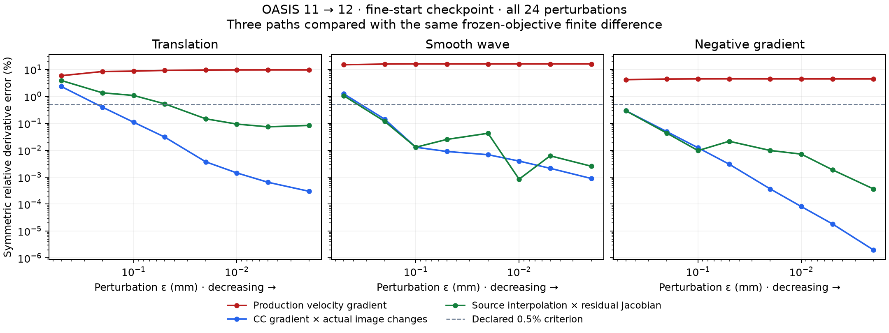
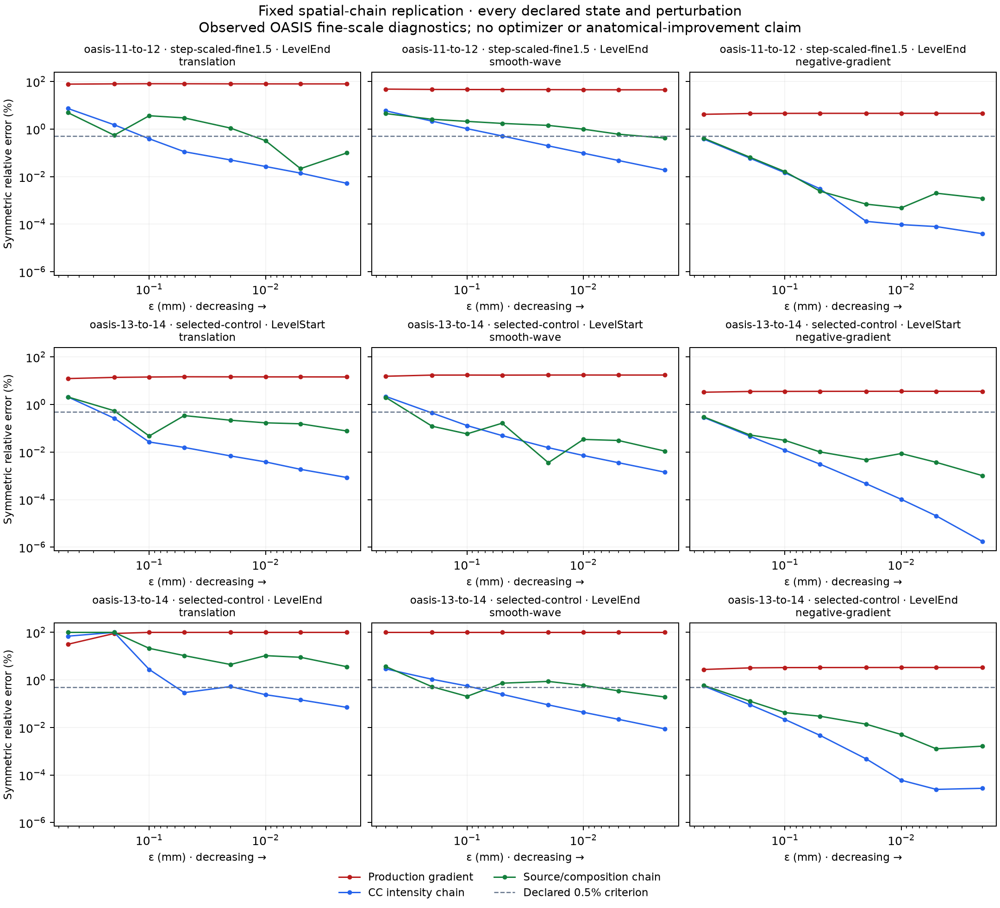
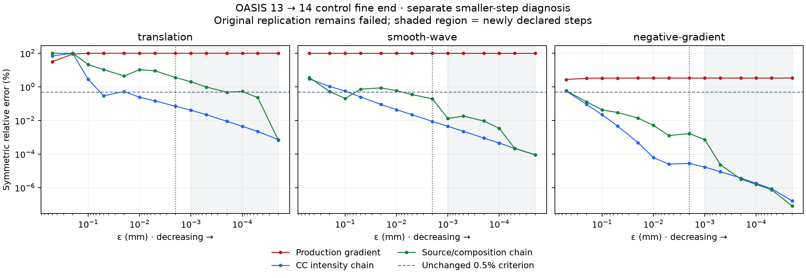

# HalfFlow source-interpolation and residual-composition derivative audit

Separately differentiating source-image interpolation and residual-map composition
passes the declared directional-derivative criterion on the observed OASIS
11 → 12 fine-start checkpoint. The unchanged production gradient fails all three
directions. This identifies a concrete candidate correction for the spatial
gradient calculation; it does not establish an anatomical improvement or qualify
HalfFlow.

This extends the [intensity-chain isolation](halfflow-intensity-chain-v1.md) under
HFQ-D01 (`bd-01M4X4DY7DQCVK33MCK3T17NA1`) and prepares HFQ-D02. The
[evidence manifest](evidence/halfflow-spatial-chain-20261014/artifact-manifest.json)
retains the complete results, source reconstruction, tests, provider review and
failed compiler attempt. MRI and dense-map payloads remain local.

## What was differentiated

Production computes finite spatial differences of images already warped onto
the midpoint lattice. An actual candidate instead composes the midpoint residual
map with a half-step, applies an affine, and samples the source-image trilinear
interpolant. These discretizations need not give the same derivative.

The diagnostic computes the source trilinear interpolant's derivative at each
actual sample point, then applies the affine, residual-map and work-grid
coordinate Jacobians in composition order. It combines those physical covectors
with the already-validated CC intensity derivatives and the action's signs and
half-step factors. Residual derivatives use symmetric slopes at work-grid
vertices. The production optimizer, gradient, support, weights, candidate
integration and accumulated regularization are unchanged.

The inspected image4s APIs provide scalar linear sampling and Sobel/Scharr image
stencils, but do not expose this arbitrary-coordinate interpolant derivative.
The [provider review](evidence/halfflow-spatial-chain-20261014/spatial-chain-build-v1/provider-review.json)
records their pinned source identities. The diagnostic differentiates the
existing HalfFlow sampler polynomial and retains the current physical owners.

Missing derivative support is counted as unavailable. Source-grid knots use a
counted symmetric slope; a simultaneous source/residual kink is not claimed to
have a unique linear derivative. On this real checkpoint, both arms evaluate
all **149,166** nonzero intensity derivatives, with **zero unavailable samples
and zero source-grid knots**.

## Measured agreement on the real checkpoint

The same three directions and eight perturbations, from 0.5 to 0.002 mm, were
declared before execution. Each direction must have a minimum symmetric relative
error at most 0.005 and a region of three consecutive decreasing-error samples.
The spatial-chain check additionally requires complete derivative support.
No criterion or tolerance was relaxed.

At the smallest perturbation, **0.002 mm**, the measured percentage errors are:

| Direction | Production gradient | Source/interpolation composition chain | CC intensity chain |
| --- | ---: | ---: | ---: |
| Translation | 9.6975% | 0.083729% | 0.0002991% |
| Smooth wave | 16.0727% | 0.0025524% | 0.0008943% |
| Negative production gradient | 4.4850% | 0.0003653% | 0.000001973% |

All three spatial-chain directions pass the full criterion, as do the three
intensity-chain directions. The production gradient fails all three. All 24
earlier production-gradient, finite-difference, loss and intensity-chain
measurements reproduce **exactly**, and the frozen current objective is unchanged.
The [receipt](evidence/halfflow-spatial-chain-20261014/spatial-chain-pilot-v1/receipt.json)
contains every verdict and support denominator.

The spatial-chain curves are not monotonically decreasing over the whole tested
range. In particular, translation retains about 0.084% error at the smallest
step. Passing the declared criterion does not establish an exact derivative
under every interpolation or boundary condition. The original negative-gradient
direction is already a descent direction in this case; these results do not
demonstrate an ascent-direction failure.

## Verification and reproduction

Seven focused tests pass on both JVM and Scala.js: four new spatial-chain checks
and three existing frozen-objective checks. The new tests cover exact trilinear
polynomials, counted knot slopes, invalid and zero-weight interpolation support,
and actual paired composition on mixed oblique grids for both symmetric and
fixed-anchor actions. The acquired-image runner compiles. The first compiler
attempt used four indices on a rank-three scalar image; the corrected access
passes, and the failed log remains in the archive.

The frozen numerical source is
`a3827bfdff07a34f5c54f5229ab92b515b1b20bf45fbf80751baa228c3f7afaf`.
The verified source patch reconstructs it from the frozen D01 engine: P01's
`control-source.tar.gz`, the D01 `instrumentation.patch`, then this archive's
`source.patch`. Run `objective_probe.py freeze` against the original verified
trajectory pilot and pass the preceding `intensity-chain-pilot-v1` as
`--derivative-baseline`; use the pinned classpath and a fresh output directory.
The run took 334.74 diagnostic wall seconds alongside other work, which does
not support a production-performance comparison.

## Remaining work

Before making this the production gradient, repeat acquired-image checks at
other states and pyramid scales, including image-order, boundary, mixed-grid and
applicable regularization cases. The synthetic mixed-grid checks are useful but
do not replace those acquired-image checks. Then test a controlled optimizer
candidate against the frozen baseline, retaining all convergence, geometry,
anatomy and runtime gates.

The [trajectory evidence](halfflow-deferred-capture-v1.md) already shows that
improving both the optimizer intensity objective and an independent fixed-region
intensity audit can worsen anatomical overlap. A more faithful gradient alone
therefore remains an unproven anatomical remedy. D01's full trajectory panel,
D02's broader audit and the qualification epic all remain open.

## Declared replication at additional acquired-image states

The [follow-up declaration](evidence/halfflow-spatial-chain-20261014/followup-declaration-v1/protocol.json)
uses the same compiled engine on three fixed states: OASIS 11 → 12's
step-scaled fine endpoint, and OASIS 13 → 14's selected-control fine start and
endpoint. Their saved losses are respectively 0.437374690028, 0.530643266102 and
0.416309794869. Each must reproduce its original loss within `1e-12` before
the same 24 perturbations are evaluated. Every attempt remains in the denominator;
no state is replaced after its derivative outcome is observed.

Four additional validator tests pass. The validator independently recomputes
finite differences from the two losses and each relative-error formula, and
reproduces the completed pilot's verdicts and support summaries exactly. The
[declaration archive](evidence/halfflow-spatial-chain-20261014/followup-declaration-v1/artifact-manifest.json)
contains those checks, frozen input/source identities and source-checkpoint
metadata. It includes no follow-up outcomes. This remains observed OASIS
fine-scale evidence; it adds neither a new optimizer policy nor a qualification
cohort.

## Replication outcome: two states pass, one fails

All three declared attempts completed and reproduced their saved losses within
`1e-12`. The unchanged production gradient fails all nine directional criteria;
the CC intensity chain passes all nine. The diagnostic spatial chain passes
eight directions, but fails translation at the OASIS 13 → 14 control endpoint.
The declared all-state replication therefore **fails**. The failed state remains
in the [complete results](evidence/halfflow-spatial-chain-20261014/followup-outcomes-v1/results.json).

| State | Translation minimum error | Smooth-wave minimum error | Negative-gradient minimum error | Spatial verdict |
| --- | ---: | ---: | ---: | --- |
| OASIS 11 → 12, step-scaled fine end | 0.02175% | 0.42047% | 0.000486% | pass |
| OASIS 13 → 14, control fine start | 0.04725% | 0.003575% | 0.001013% | pass |
| OASIS 13 → 14, control fine end | **3.58912%** | 0.19130% | 0.001263% | **fail** |

These are minima over the eight predeclared perturbations, not errors chosen
from an expanded search. Passing also requires the declared three-point
decreasing-error region. All six image arms have complete derivative support
and zero counted source interpolation knots. Neither missing support nor an
exact source-grid knot accounts for this failure.

At the failing endpoint and `ε=0.002 mm`, the actual objective finite difference
is `-0.000127239475`, the spatial-chain derivative is `-0.000118422387`, and the
production derivative is `+0.000457672159`. The CC intensity-chain discrepancy is
0.07011%, while the spatial discrepancy is 3.58912%. The finite difference still
varies with step size. Smaller-step diagnostics are needed to distinguish
crossings of nearby interpolation cells from a remaining chain-rule defect;
the present result establishes neither explanation. Any extension must be a
separate declared experiment and preserve this failed replication.

The [outcome archive](evidence/halfflow-spatial-chain-20261014/followup-outcomes-v1/artifact-manifest.json)
verifies every source/input identity, recomputes the directional verdicts and
retains all logs and results. Its nine-panel plot was visually checked. This
supports further diagnosis, not promotion to the production optimizer or a
claim of improved anatomical registration.

## Separate smaller-step experiment

The [smaller-step declaration](evidence/halfflow-spatial-chain-20261014/smaller-step-declaration-v1/declared-protocol.json)
fixes the failed OASIS 13 → 14 control endpoint, all three directions, and six
additional steps: `0.001`, `0.0005`, `0.0002`, `0.0001`, `0.00005` and
`0.00002 mm`. It first repeats all original 24 measurements and requires exact
agreement. The 18 additional measurements are assessed separately using the
same 0.5% error threshold and three-point decreasing-error rule. A favorable
extension cannot change the original failed replication verdict.

The new frozen source
`a499b631c988a42c82b9b7f14a439a23378dde54538eb5d14598f884ff0e33de`
differs from the pilot only in the diagnostic runner's optional validated step
list and its test. Both runner tests pass, and a hash-verified source patch is
included in the [declaration archive](evidence/halfflow-spatial-chain-20261014/smaller-step-declaration-v1/artifact-manifest.json).
Derivative kernels and optimizer policies are unchanged. The experiment asks
about asymptotic agreement at this checkpoint; even a pass would not establish
finite-step accuracy, a globally smooth gradient or improved anatomy.

The extension completed successfully in 647.04 diagnostic wall seconds. All
24 original measurements reproduced exactly. On the 18 newly declared
measurements, all three spatial-chain directions and all three CC intensity-chain
directions pass the unchanged criterion; the production gradient passes none.
At the smallest new step, `ε=0.00002 mm`:

| Direction | Actual objective finite difference | Spatial-chain derivative | Spatial relative error | Production relative error |
| --- | ---: | ---: | ---: | ---: |
| Translation | -0.000118424012 | -0.000118422387 | 0.0006861% | 100% |
| Smooth wave | -0.001027035369 | -0.001027037237 | 0.00009092% | 100% |
| Negative production gradient | -0.046999237312 | -0.046999237387 | 0.00000007987% | 3.34048% |

This supports the spatial-chain derivative as the small-step limit at the
previously failing checkpoint. The finite-step curve is nonmonotone, and the
translation result changes substantially below the original minimum step.
The extension is consistent with nearby interpolation-cell crossings affecting
finite differences, but does not count those crossings or establish that they
are the sole cause. The original eight-step replication remains failed.
Production and actual directional derivatives have opposite signs for
translation and smooth wave here; the negative production-gradient direction
itself remains a descent direction.

The [complete extension receipt](evidence/halfflow-spatial-chain-20261014/smaller-step-outcomes-v1/receipt.json)
and [verified archive](evidence/halfflow-spatial-chain-20261014/smaller-step-outcomes-v1/artifact-manifest.json)
retain the original verdict, all measurements, source patch and hashes. The
plot was visually checked. Other pyramid scales, cohorts, image orders and
boundary conditions still require testing before changing the optimizer.

The [pyramid-scale and cross-cohort study](halfflow-pyramid-chain-v1.md) now
declares a fine-scale neutrality control, three coarse checkpoints and an MMRR
fine checkpoint. It reuses the production pyramid builder and preserves the
separate original-step and smaller-step verdicts.
